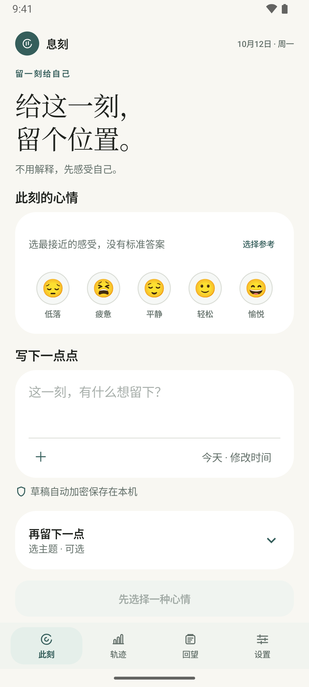
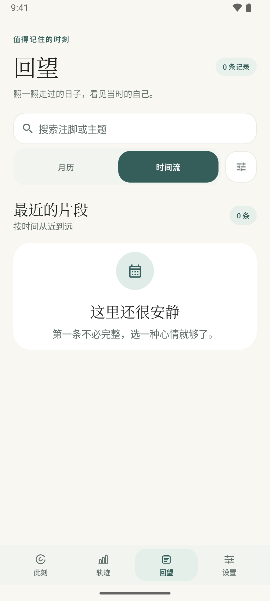
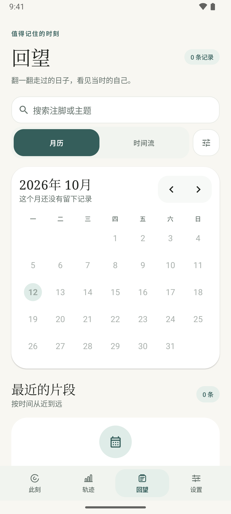
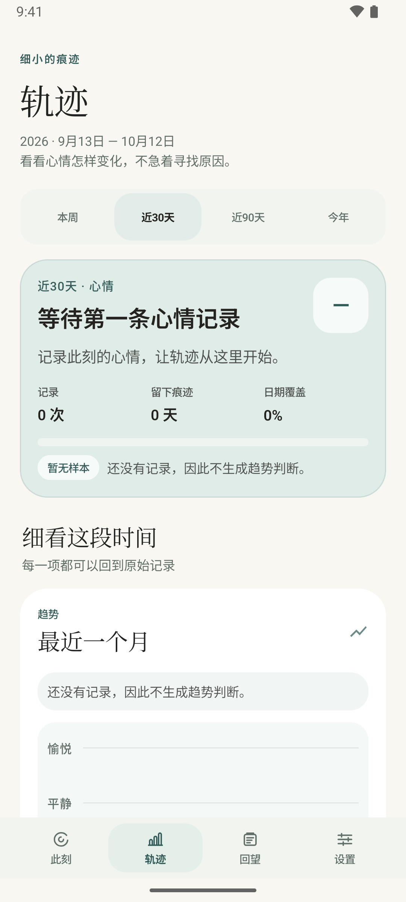
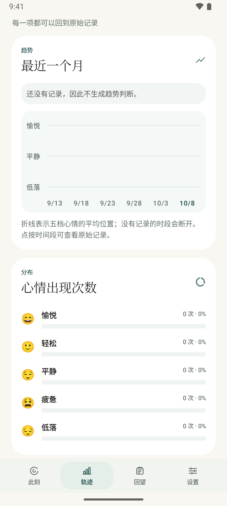
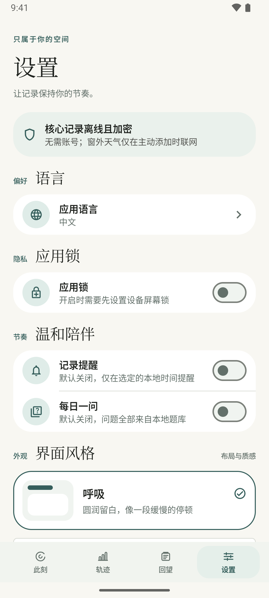

# 息刻

> 停一刻，听见自己。

息刻是一款离线优先的个人感受日记。选一种最接近当下的心情，就能记下一刻；文字、照片、语音和窗外天气都可以按需添加。应用不需要账号，记录默认只留在本机。

**不想写长篇日记，也能留住今天的心情。**

| 平台 | 当前状态 | 入口 |
| --- | --- | --- |
| Android 8.0 及以上 | 已发布 APK | [下载 APK](https://github.com/hi-fullmoon/Xike/releases/latest) · [安装与使用](android/README.md) |
| iPhone，iOS 17 及以上 | 开发版，待真机验收 | [iOS 构建与验收](ios/README.md) |

[查看 Android 更新记录](https://github.com/hi-fullmoon/Xike/releases) · [反馈问题与建议](https://github.com/hi-fullmoon/Xike/issues)

- **无需注册，离线可用**：打开就能记录；天气查询与可选 AI 回顾由用户主动发起。
- **按自己的方式表达**：只选一个心情也可以，文字、照片和语音按需添加。
- **随时回望，也能带走**：通过月历、时间流和心情轨迹回看记录，支持备份导出与恢复。

## Android 应用预览

以下画面于 2026 年 10 月 12 日在 Android 16（API 36）模拟器上拍摄，分辨率为 1080 × 2400。画面使用雾松主色、呼吸风格与中文界面，展示尚未录入日记的初始状态，不包含私人记录。点击图片可查看原图。

| 记录此刻 | 回望（时间流） |
| :---: | :---: |
|  |  |

| 回望（月历） | 轨迹（近 30 天） |
| :---: | :---: |
|  |  |

| 轨迹（趋势与分布） | 设置与隐私 |
| :---: | :---: |
|  |  |

## 文档

- [开发与验收入口](docs/README.md)
- [备份格式与跨端迁移](docs/backup-format.md)

## 反馈与参与

欢迎通过 [GitHub Issues](https://github.com/hi-fullmoon/Xike/issues) 报告问题或提出建议。报告问题时，请附上应用版本、手机型号、系统版本、复现步骤和实际表现；截图或录屏请先遮盖日记内容、照片、地点等私人信息。

如果你愿意参与开发，可以先在 Issue 中说明想解决的问题或改进方向，再提交 Pull Request。也欢迎分享使用体验，帮助息刻变得更顺手。

## 开源许可

息刻采用 [MIT License](LICENSE) 开源。
