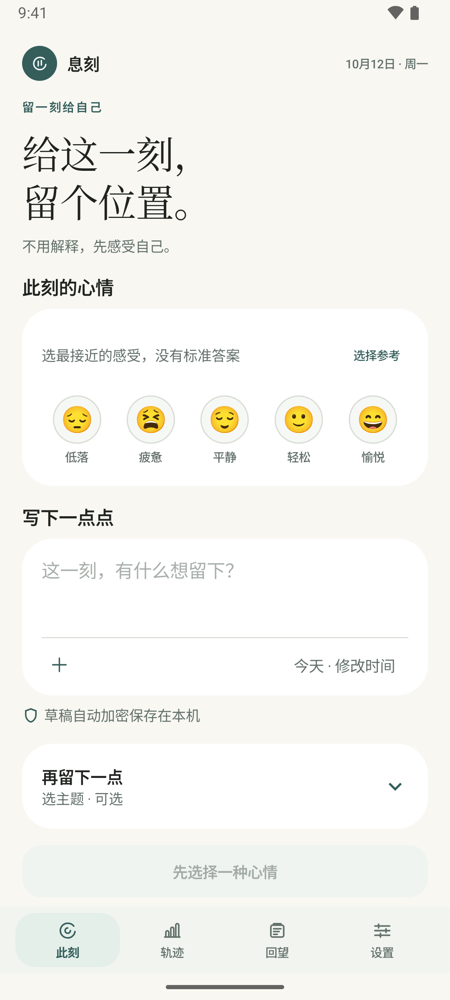
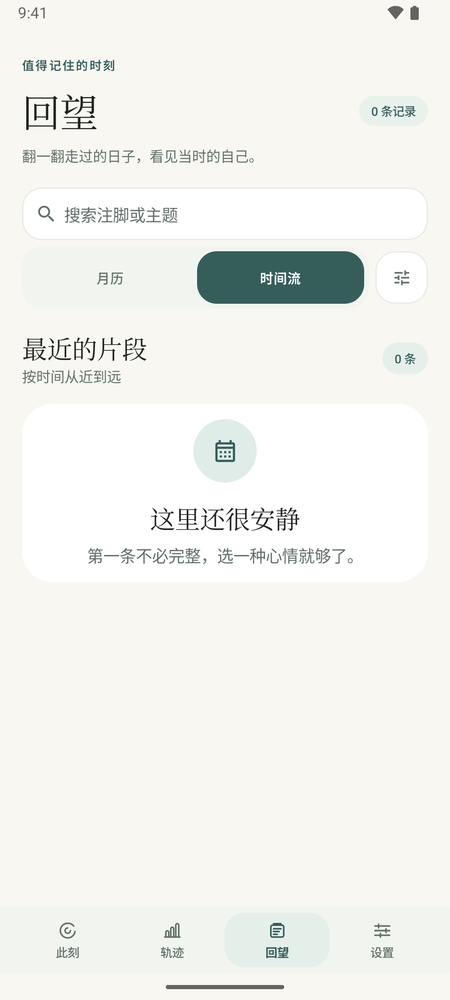
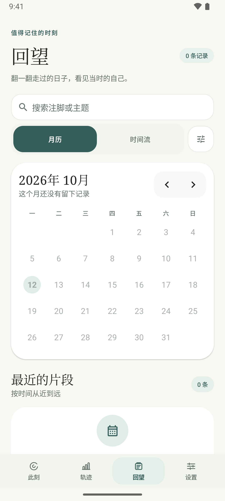
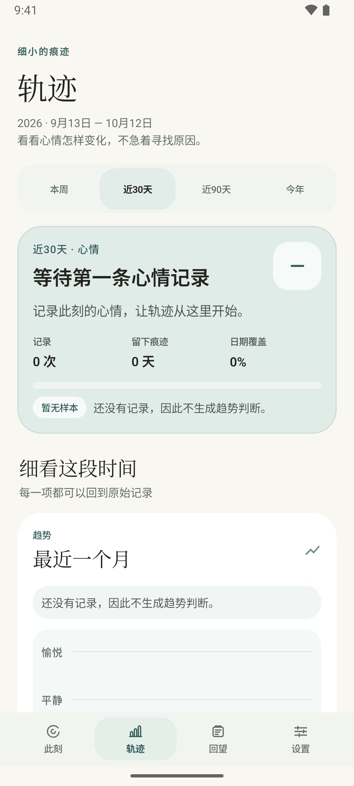
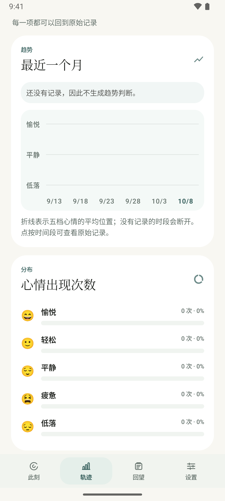
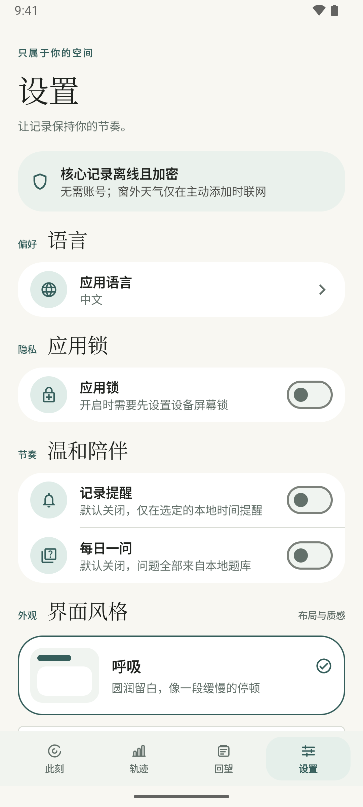

# 息刻

> 停一刻，听见自己。

息刻是一款离线优先的 Android 个人感受日记。选一种最接近当下的心情，就能记下一刻；文字、主题、照片、语音和窗外天气都可以按需添加。应用不需要账号，记录默认只留在本机。

**不想写长篇日记，也能留住今天的心情。**

[下载 Android APK](https://github.com/hi-fullmoon/Xike/releases/latest) · [查看更新记录](https://github.com/hi-fullmoon/Xike/releases) · [反馈问题与建议](https://github.com/hi-fullmoon/Xike/issues)

- **无需注册，离线可用**：打开就能记录；主动查询天气时才会联网。
- **按自己的方式表达**：只选一个心情也可以，文字、照片和语音按需添加。
- **随时回望，也能带走**：通过月历、时间流和心情轨迹回看记录，支持备份导出与恢复。

## 下载与安装

支持 **Android 8.0 及以上**。

1. 打开[最新版本发布页](https://github.com/hi-fullmoon/Xike/releases/latest)，在 **Assets** 中下载以 `.apk` 结尾的文件。
2. 在手机上打开下载的 APK。如果系统提示，请为下载时使用的浏览器或文件管理器允许“安装未知应用”，安装完成后可关闭该权限。
3. 打开息刻，选择最接近当下的心情，按需添加内容并保存第一条记录。

`.aab` 用于应用商店分发，不能直接点击安装；`Source code` 是源码压缩包。发布页同时提供 `SHA256SUMS.txt`，可用于核对下载文件的完整性。

更新时下载新版 APK 并覆盖安装。卸载、清除应用数据或更换手机前，请先在设置中导出备份，并妥善保管加密备份的密码。

## 应用预览

以下画面于 2026 年 10 月 12 日使用当前源码构建，在 Android 16（API 36）模拟器上拍摄，分辨率为 1080 × 2400。画面使用雾松主色、呼吸风格与中文界面，展示尚未录入日记的初始状态，不包含私人记录。点击图片可查看原图。

| 记录此刻 | 回望（时间流） |
| :---: | :---: |
| <a href="docs/screenshots/moment.png"></a> | <a href="docs/screenshots/archive.png"></a> |

| 回望（月历） | 轨迹（近 30 天） |
| :---: | :---: |
| <a href="docs/screenshots/calendar.png"></a> | <a href="docs/screenshots/insights.png"></a> |

| 轨迹（趋势与分布） | 设置与隐私 |
| :---: | :---: |
| <a href="docs/screenshots/insights-detail.png"></a> | <a href="docs/screenshots/settings.png"></a> |

## 主要功能

- **轻量记录**：五种心情任选；可添加注脚、主题、最多 9 张照片、一段最长 5 分钟的语音，以及一段最长 5 分钟、最大 500 MB 的视频。视频支持系统摄像机拍摄或从相册选择，保留原始文件格式，可预览、替换和移除。录音支持暂停、继续和试听，也可为过去的日期补记。未完成的内容会作为加密草稿留在本机。
- **回望与检索**：在月历和时间流之间切换；按注脚与主题搜索，并组合心情、主题、日期和照片筛选。已保存的记录可以编辑；删除需要确认，并在提示消失前支持撤销。
- **温和的轨迹**：查看心情分布、记录覆盖度、前一周期对比、主题变化和工作日／周末对照。统计会显示样本范围与限制，可回到对应原始记录。本地回望文字在设备内生成。
- **自主节奏**：可按星期和时间设置提醒、夜间勿扰或暂停一周，也可启用本地“每日一问”。两者默认关闭；长按桌面图标可直接“记录此刻”。

## 开发与运行

使用 Android Studio 打开本目录，准备 Android SDK Platform 36、Build Tools 36.1.0 和 JDK 17（Android Studio 自带的 JBR 也可以）。最低支持 Android 8.0（API 26）。

在 macOS／Linux 上构建并安装到已连接的设备或模拟器：

```bash
./gradlew :app:assembleDebug
./gradlew :app:installDebug
```

Windows 使用 `gradlew.bat` 执行相同任务；也可以在 Android Studio 中运行 `app` 配置。调试 APK 位于 `app/build/outputs/apk/debug/app-debug.apk`。

## 数据与隐私

日记、主题和搜索索引保存在 Room／SQLCipher 加密数据库中，随机数据库口令由 Android Keystore 中不可导出的密钥封装。照片、语音、视频及视频封面分别加密，存放在应用私有目录。视频播放按需解密，不生成未加密的播放副本；移除附件不删除相册原文件。系统摄像机拍摄的照片和视频会同时保存在系统相册。可用系统面容、指纹或设备密码开启应用锁，并选择离开应用后的锁定时间。

只有主动添加“此刻窗外”时才会联网查询 Open-Meteo 天气；选择定位时仅获取一次前台位置，支持精确定位，也兼容只允许粗略定位。精确定位质量足够且地址服务返回相应信息时，地点可显示到区、街道；也可以拒绝定位并手动输入城市。默认使用系统定位和系统地址服务。天气请求使用四舍五入到 3 位小数的 WGS84 坐标。经纬度不会写入草稿、日记或备份。保存的地点文字与天气快照会和日记一起加密；补记过去时不会自动附加今天的天气。

可选高德定位：在设置页底部版本号上 2 秒内连续点击 3 次，打开“高德定位配置”。填写绑定当前包名和签名 SHA-1 的 Android SDK Key，阅读并同意高德定位说明后可开启。弹窗支持复制包名与 SHA-1、隐藏或显示 Key、测试定位和清除 Key；清除后仍需点击“保存”才会生效。Key 仅在本机加密保存，不进入日记备份。保存配置不发起定位；主动测试会单次请求高德，不写入日记或草稿。关闭开关后恢复系统定位，已保存的 Key 保留。

当前高德定位依赖的原生组件提供 ARM 库。应用进程无法解析到兼容原生库时，会提示运行环境不支持，不会误报为 Key 鉴权失败；系统定位仍可使用。模拟器的 ARM 转译配置及海外链路调查见[高德定位验证记录](docs/amap-location-investigation.md)。

精确定位且精度在 100 米以内时，地点名称优先显示高德返回的 POI（如咖啡厅），未返回时使用 AOI（如园区），再回退到街道。完整地址保留，并补入尚未包含的地点名称；粗略权限或精度不足时仅显示行政区域。POI 可能是附近地点，不代表已确认进入该店铺；不会额外发起周边搜索。

新获取的窗外快照会分别显示地点来源（高德定位、系统定位或手动选择）及天气获取时间／Open-Meteo 来源。地点来源随草稿、日记和备份保存，不随当前定位开关变化；旧快照没有来源记录时不推断、不补标，重新获取后才显示来源。

启用后，高德会处理经纬度及相关网络、设备信息以提供定位和地址；详细范围见弹窗中的高德隐私政策。高德返回国内 GCJ-02 坐标时，使用 Hutool 的近似转换得到 WGS84 坐标，再取整查询天气，不再依赖城市名称搜索；该转换只用于天气查询。地址语言跟随应用的中文或英文设置，英文返回中残留的中文继续使用现有地区词典转拼音。高德已取得 WGS84 位置但未返回地址时，复用系统地址服务补全文字，不再获取第二次位置；测试结果会标明地址由系统补全。定位失败时显示错误，可关闭高德恢复系统定位，或手动选城市。应用不申请后台定位权限，取消、超时、离开前台或修改配置会停止本次请求并释放客户端。

备份通过系统文件选择器导出到用户选定的位置，包含全部已保存记录、照片、语音和视频，不包含未保存草稿。默认使用用户密码进行 AES-GCM 加密，保存为 `.xike`；也可关闭加密，保存为 `.zip`。恢复默认合并，保留本机记录、跳过同一记录的重复版本，并在冲突时保留双方版本；也可选择再次确认后替换全部内容。恢复前创建加密安全快照，支持撤销最近一次恢复。两种格式都包含离线阅读页 `index.html`：未加密 ZIP 解压后可直接用浏览器打开；加密备份必须先在应用内输入密码，不能直接用浏览器查看。未加密文件及解压出的内容应只放在自己信任的位置。只有用户主动分享内容时，本地回望文字才会离开息刻。

## 反馈与参与

欢迎通过 [GitHub Issues](https://github.com/hi-fullmoon/Xike/issues) 报告问题或提出建议。报告问题时，请附上应用版本、手机型号、Android 版本、复现步骤和实际表现；截图或录屏请先遮盖日记内容、照片、地点等私人信息。

如果你愿意参与开发，可以先在 Issue 中说明想解决的问题或改进方向，再提交 Pull Request。也欢迎分享使用体验，帮助息刻变得更顺手。

## 更多文档

- [仓库说明](docs/repository-overview.md)：技术栈、架构、数据安全边界与目录。
- [应用锁设计](docs/app-lock-design.md)：身份验证与自动锁定取舍。
- [备份格式与离线阅读](docs/backup-format.md)：加密选项、ZIP 内容及恢复校验。
- [GitHub Release 流水线](docs/github-release-pipeline.md)：发布签名与自动构建。

推送 `vMAJOR.MINOR.PATCH` 标签后，GitHub Actions 会执行测试、Lint、签名构建，并把 APK、AAB 和 SHA-256 校验文件发布到 GitHub Release；首次发布需要先配置签名。

## 开源许可

息刻采用 [MIT License](LICENSE) 开源。
