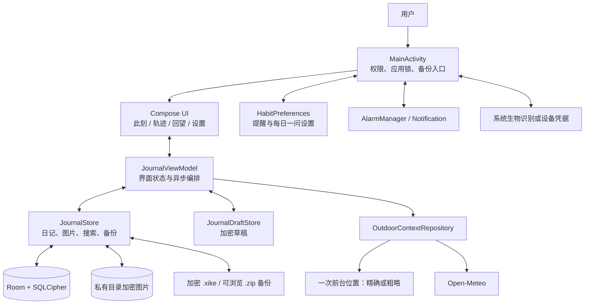

# 息刻（Xike）仓库说明

> 文档依据：仓库在 2026-08-27 的代码与配置状态。

## 1. 项目概述

息刻是一款面向 Android 的离线优先个人感受日记应用，产品标语是“停一刻，听见自己”。它希望让用户在十几秒内记录当下，并在之后安全、可靠地找回和理解这些记录。

应用不要求账号，也没有自建服务端。日记正文、主题、搜索索引、图片和语音附件默认保存在设备本地并加密；仅当用户主动添加“此刻窗外”时，应用才会请求一次前台位置并调用 Open-Meteo 获取当前天气，支持精确定位并兼容粗略定位。提醒、每日一问和分析均在设备本地完成。

当前仓库是一个单模块 Android 工程，应用包名为 `com.xike.app`，最低支持 Android 8.0（API 26），目标版本为 API 36。

## 2. 一句话定位

**一个无账号、弱联网、重视数据所有权和隐私边界的 Android 情绪日记。**

它不把重点放在社交、云同步或 AI 解读上，而是优先建设快速记录、本地检索、可信洞察、加密存储和可迁移备份。

## 3. 核心能力

### 记录此刻

- 5 档心情：低落、疲惫、平静、轻松、愉悦。
- 13 个预设主题，覆盖工作、关系、身体、睡眠、兴趣等场景；旧主题在历史记录中保留，并归入对应主题的筛选与统计。
- 最多 280 字注脚。
- 每条记录可添加 1 段最长 5 分钟的语音，支持暂停、继续和试听。
- 每条记录最多添加 9 张图片，单张上限 20 MB。
- 支持系统相机拍摄和系统照片选择器。
- 支持补记过去的日期与时间。
- 未完成内容会保存为加密草稿，进程重建后可继续编辑。
- 用户可主动添加地点文字、当前温度和天气状况；精确定位质量足够且系统地址服务可用时，地点显示到区、街道。

### 回望与查找

- 月历和时间流两种浏览方式。
- 基于 Room FTS4 的本地全文搜索。
- 可组合筛选心情、主题、日期范围和是否包含图片。
- 支持查看、编辑和删除已有记录。
- 删除需要确认，并提供一次短时撤销。

### 轨迹与洞察

- 支持本周、近 30 天、近 90 天和今年等时间范围。
- 展示心情分布、记录覆盖度、前一周期对比和主题趋势。
- 提供工作日与周末对照。
- 每项分析都保留样本范围说明，并可下钻到原始记录。
- 回顾文字在本机生成；只有用户主动分享时才交给其他应用。

### 隐私与数据所有权

- SQLCipher 加密整个 Room 数据库。
- Android Keystore 中的不可导出 AES 密钥用于封装随机数据库口令。
- 图片与语音附件独立加密后保存在应用私有目录。
- 草稿保存在 `EncryptedSharedPreferences` 中。
- 应用锁使用系统面容、指纹或设备凭据，不自建 PIN 体系。
- 支持密码加密 `.xike` 或未加密 `.zip` 备份；归档包含离线 HTML 阅读页，恢复前校验并可在恢复后撤销一次。
- 禁止 Android 系统自动备份应用数据。

### 温和习惯支持

- 可按时间和星期配置本地提醒。
- 支持夜间勿扰和暂停一周。
- 支持桌面“记录此刻”快捷入口。
- 提供 3 套完全本地的每日一问题库。
- 所有提醒和问题功能默认关闭，不使用连续打卡惩罚。

## 4. 技术栈

| 类别 | 选型 |
| --- | --- |
| 语言 | Kotlin 2.3.21 |
| 构建系统 | Gradle Kotlin DSL、Android Gradle Plugin 8.13.2 |
| Java 工具链 | JDK 17 |
| UI | Jetpack Compose、Material 3 |
| 状态与异步 | Android ViewModel、Compose State、Kotlin Coroutines、Flow |
| 数据库 | Room 2.8.4、FTS4、SQLCipher 4.17.0 |
| 本地加密 | Android Keystore、AndroidX Security Crypto、AES-GCM |
| 身份验证 | AndroidX Biometric |
| 外部天气 | Open-Meteo Forecast 与 Geocoding API |
| 测试 | JUnit 4、Room Testing、AndroidX Test、Compose UI Test |
| 持续集成 | GitHub Actions |

版本配置以 [`app/build.gradle.kts`](../app/build.gradle.kts) 为准。CI 发布时通过 `XIKE_VERSION_NAME` 和 `XIKE_VERSION_CODE` 注入版本；未注入时本地构建默认使用 `0.1.0` 和 `1`。

## 5. 架构概览

工程采用单 Activity、Compose UI 和 ViewModel 驱动的结构。它接近轻量 MVVM，但没有拆分成多个 Gradle 功能模块；业务、存储和界面主要按 Kotlin 文件划分。



典型的保存链路如下：

1. 用户在 `MomentScreen` 中选择心情、主题、注脚和图片。
2. `JournalViewModel` 持有当前草稿状态，并将草稿同步到加密偏好设置。
3. 保存时，`JournalStore` 先导入并加密图片，再通过事务写入日记、主题、图片引用和全文搜索文档。
4. Room 的 `Flow` 推送最新记录列表，Compose 界面自动刷新。

## 6. 主要代码模块

| 文件 | 职责 |
| --- | --- |
| [`MainActivity.kt`](../app/src/main/java/com/xike/app/MainActivity.kt) | 系统入口；处理权限、生物识别、应用生命周期及系统结果回调协调。 |
| [`XikeApp.kt`](../app/src/main/java/com/xike/app/XikeApp.kt) | 应用组合入口、底部导航、页面状态、备份文件选择及恢复协调。 |
| [`AppLockSessionState.kt`](../app/src/main/java/com/xike/app/AppLockSessionState.kt) | 应用锁会话状态、后台时间与系统 Activity 监控状态。 |
| [`AppLockUi.kt`](../app/src/main/java/com/xike/app/AppLockUi.kt) | 冷启动锁定页与会话锁定层。 |
| [`BackupDialogs.kt`](../app/src/main/java/com/xike/app/BackupDialogs.kt) | 导出、密码与恢复确认弹窗，及已有导出请求状态。 |
| [`AppOperationDialogs.kt`](../app/src/main/java/com/xike/app/AppOperationDialogs.kt) | 加载处理和数据错误弹窗。 |
| [`JournalViewModel.kt`](../app/src/main/java/com/xike/app/JournalViewModel.kt) | 连接 UI 与数据层；编排初始化、草稿、增删改查、天气、备份和恢复。 |
| [`JournalStore.kt`](../app/src/main/java/com/xike/app/JournalStore.kt) | 日记仓储；负责数据库访问、附件加密、删除撤销、旧数据迁移、备份与恢复。 |
| [`JournalDatabase.kt`](../app/src/main/java/com/xike/app/JournalDatabase.kt) | Room 实体、DAO、事务、FTS4 搜索表、SQLCipher 初始化和数据库迁移。 |
| [`JournalDraft.kt`](../app/src/main/java/com/xike/app/JournalDraft.kt) | 草稿模型、规范化、JSON 序列化和加密持久化。 |
| [`JournalSearch.kt`](../app/src/main/java/com/xike/app/JournalSearch.kt) | 搜索条件、分页结果、内存筛选工具和月历日期计算。 |
| [`JournalAnalytics.kt`](../app/src/main/java/com/xike/app/JournalAnalytics.kt) | 纯 Kotlin 的周期统计、心情分布、覆盖度、主题与工作日/周末分析。 |
| [`SystemActivityCallbacks.kt`](../app/src/main/java/com/xike/app/SystemActivityCallbacks.kt) | 系统 Activity 结果协调的 CompositionLocal 声明。 |
| [`JournalInputComponents.kt`](../app/src/main/java/com/xike/app/JournalInputComponents.kt) | 此刻与编辑共用的注脚、工具栏和媒体操作组件。 |
| [`RecordedAtPicker.kt`](../app/src/main/java/com/xike/app/RecordedAtPicker.kt) | 原生日期和时间选择，保留未来时间校验及弹窗协调。 |
| [`MoodPicker.kt`](../app/src/main/java/com/xike/app/MoodPicker.kt) | 心情选择、说明及私有视觉规则。 |
| [`JournalTopicPicker.kt`](../app/src/main/java/com/xike/app/JournalTopicPicker.kt) | 主题目录、选择组件和计数说明。 |
| [`JournalEntryCard.kt`](../app/src/main/java/com/xike/app/JournalEntryCard.kt) | 回望与轨迹复用的记录卡片及私有时间格式。 |
| [`JournalPhotoUi.kt`](../app/src/main/java/com/xike/app/JournalPhotoUi.kt) | 照片添加入口、缩略图、拼图、图库和预览位图加载。 |
| [`XikePageComponents.kt`](../app/src/main/java/com/xike/app/XikePageComponents.kt) | 跨页面复用的页头和内容卡片。 |
| [`MomentScreen.kt`](../app/src/main/java/com/xike/app/MomentScreen.kt) | 此刻页面、草稿与媒体交互及专用辅助组件。 |
| [`OutdoorContextUi.kt`](../app/src/main/java/com/xike/app/OutdoorContextUi.kt) | 窗外信息、城市选择及相关操作组件。 |
| [`SettingsScreen.kt`](../app/src/main/java/com/xike/app/SettingsScreen.kt) | 设置页面、专用弹窗、风格预览和辅助组件。 |
| [`XikeTheme.kt`](../app/src/main/java/com/xike/app/XikeTheme.kt) | 六种主色、三种风格、字体、尺寸规则和共享访问接口。 |
| [`XikeNavigationBar.kt`](../app/src/main/java/com/xike/app/XikeNavigationBar.kt) | 页面导航标识、底部导航及选中状态展示。 |
| [`JournalEntryDetailDialog.kt`](../app/src/main/java/com/xike/app/JournalEntryDetailDialog.kt) | 回望与轨迹共用的日记详情及专用展示组件。 |
| [`JournalEntryEditDialog.kt`](../app/src/main/java/com/xike/app/JournalEntryEditDialog.kt) | 编辑弹窗、专用照片组件及编辑状态与操作协调。 |
| [`JournalArchiveUi.kt`](../app/src/main/java/com/xike/app/JournalArchiveUi.kt) | 回望、搜索、筛选、月历和删除界面。 |
| [`JournalInsightsUi.kt`](../app/src/main/java/com/xike/app/JournalInsightsUi.kt) | 轨迹页面、周期选择、计算状态与下钻跳转协调。 |
| [`JournalInsightsCards.kt`](../app/src/main/java/com/xike/app/JournalInsightsCards.kt) | 轨迹概况、周期比较、主题、日期类型及本地回顾入口卡片。 |
| [`JournalInsightsCharts.kt`](../app/src/main/java/com/xike/app/JournalInsightsCharts.kt) | 趋势图、分布图及图表滚动与绘制。 |
| [`JournalInsightsSection.kt`](../app/src/main/java/com/xike/app/JournalInsightsSection.kt) | 轨迹组件共用的分节卡片、比例条与样本说明。 |
| [`LocalReviewDialog.kt`](../app/src/main/java/com/xike/app/LocalReviewDialog.kt)、[`InsightDrilldownDialog.kt`](../app/src/main/java/com/xike/app/InsightDrilldownDialog.kt) | 本地回顾与原始记录弹窗，继续复用共享日记详情。 |
| [`OutdoorContext.kt`](../app/src/main/java/com/xike/app/OutdoorContext.kt) | 一次前台定位、区与街道查询、城市检索、天气请求和天气快照规范化。 |
| [`PhotoCapture.kt`](../app/src/main/java/com/xike/app/PhotoCapture.kt) | 系统相机拍摄、相册写入、未完成拍摄清理和照片来源 UI。 |
| [`XikeAudioRecorder.kt`](../app/src/main/java/com/xike/app/XikeAudioRecorder.kt) | 既有麦克风录音器、录音文件生成及释放。 |
| [`VoiceCaptureUi.kt`](../app/src/main/java/com/xike/app/VoiceCaptureUi.kt) | 录音手势、返回处理、波形及待保存录音界面。 |
| [`VoicePlaybackUi.kt`](../app/src/main/java/com/xike/app/VoicePlaybackUi.kt) | 播放与互斥协调、进度控件、时长显示与临时播放文件清理。 |
| [`AudioEditServices.kt`](../app/src/main/java/com/xike/app/AudioEditServices.kt) | 既有录音编辑导入与释放接口。 |
| [`ReminderScheduler.kt`](../app/src/main/java/com/xike/app/ReminderScheduler.kt) | 本地闹钟、通知、开机/时区变化后的提醒重排。 |
| [`HabitPreferences.kt`](../app/src/main/java/com/xike/app/HabitPreferences.kt) | 提醒、勿扰、暂停和每日一问设置。 |
| [`AppearancePreferences.kt`](../app/src/main/java/com/xike/app/AppearancePreferences.kt) | 保存非敏感的界面风格与主色镜像，使锁定页在数据库打开前也能保持用户外观。 |
| [`AppLockPreferences.kt`](../app/src/main/java/com/xike/app/AppLockPreferences.kt) | 应用锁开关和自动锁定时间设置。 |
| [`DatabaseKeyManager.kt`](../app/src/main/java/com/xike/app/DatabaseKeyManager.kt) | 创建随机 SQLCipher 口令，并使用 Android Keystore AES-256-GCM 密钥封装。 |

## 7. 数据模型与持久化

当前 Room schema 版本为 4，包含以下表：

| 表 | 用途 |
| --- | --- |
| `journal_entries` | 日记主记录，包括时间、心情、注脚和可选天气快照。 |
| `journal_tags` | 按顺序保存每条日记的主题。 |
| `journal_images` | 按顺序保存每条日记引用的加密图片文件名。 |
| `journal_audios` | 保存每条日记的加密语音文件名、时长和媒体类型。 |
| `journal_entries_fts` | FTS4 全文搜索文档，索引注脚和主题。 |
| `app_settings` | 界面风格与主色调的兼容镜像、旧数据迁移标记和搜索索引版本等应用设置。 |

`journal_tags` 和 `journal_images` 通过外键关联日记，删除主记录时级联删除引用。新增、更新、删除、批量替换和搜索索引重建均由 DAO 事务封装。

图片文件不直接存入数据库。数据库只保存随机文件名，实际内容使用 `EncryptedFile` 独立加密后写入应用私有目录。启动后会异步清理没有被日记或待撤销删除引用的孤儿图片。

## 8. 安全与网络边界

### 数据库密钥

首次创建数据库时，应用生成 32 字节随机 SQLCipher 口令。口令由 Android Keystore 中不可导出的 AES-256-GCM 密钥封装后再保存；如果数据库存在但封装口令丢失，应用会停止打开数据库，以避免用新密钥覆盖原数据。

### 备份格式

当前备份使用流式格式：清单和图片先写入 ZIP 流，再使用由用户密码派生的 AES-256-GCM 密钥加密。密钥派生使用 PBKDF2-HMAC-SHA256、随机盐和 210,000 次迭代。恢复过程会限制日记数量、图片数量、单图大小、总图片大小和文件名，先在临时目录完整校验，再替换设备内容。

恢复前会生成设备内加密撤销快照；成功恢复后可以撤销一次。代码同时保留对旧版备份格式的兼容读取。

### 联网范围

应用拥有 `INTERNET` 权限，但常规记录、搜索、洞察、提醒、加密和备份均不依赖网络。当前唯一明确的应用内网络调用是用户主动触发的 Open-Meteo 天气与城市查询：

- 只请求一次前台位置，支持精确定位并兼容粗略定位，不进行后台定位。
- 系统地址服务使用坐标查询地点；天气请求前将经纬度四舍五入到 3 位小数。
- 经纬度不写入草稿、数据库或备份。
- 日记只保存地点文字和当时的天气快照。

## 9. 目录结构

```text
Xike/
├── app/
│   ├── build.gradle.kts              # Android 应用模块配置
│   ├── schemas/                      # 导出的 Room schema 1–3
│   └── src/
│       ├── main/                     # 应用代码、Manifest 与资源
│       ├── test/                     # JVM 单元测试
│       └── androidTest/              # 数据库、迁移与 Compose 仪器测试
├── docs/
│   ├── repository-overview.md        # 本文档
│   ├── roadmap.md                    # 产品路线图
│   ├── local-development.md          # 本地开发环境
│   ├── app-lock-design.md            # 应用锁设计
│   ├── release-checklist.md          # 发布前检查清单
│   └── github-release-pipeline.md    # 发布流水线说明
├── scripts/check-jdk17.sh            # JDK 17 环境自检
├── .github/workflows/ci.yml          # PR 验证
├── .github/workflows/release.yml     # 标签触发发布
├── build.gradle.kts                  # 根构建插件版本
├── settings.gradle.kts               # 仓库与模块声明
└── README.md                         # 面向使用者的项目首页
```

## 10. 本地开发

### 环境要求

- JDK 17。
- Android SDK Platform 36。
- Android SDK Build Tools 36.1.0。
- Android Studio，或可执行 Android Gradle 任务的命令行环境。

macOS 或 Linux 可先运行：

```bash
./scripts/check-jdk17.sh
```

执行与 PR CI 一致的主要验证：

```bash
./gradlew testDebugUnitTest lintDebug assembleDebug assembleDebugAndroidTest
```

连接 API 26 以上的真机或模拟器后运行设备测试：

```bash
./gradlew connectedDebugAndroidTest
```

更详细的环境说明见 [`docs/local-development.md`](local-development.md)。

## 11. 测试与质量保障

仓库同时包含 JVM 单元测试和 Android 仪器测试。

### JVM 测试重点

- 洞察统计、时区和日期边界。
- 搜索与筛选逻辑。
- 草稿规范化。
- 提醒和每日一问设置。
- 应用锁超时判断。
- 天气快照与时间编辑规则。

### Android 仪器测试重点

- Room DAO 和数据库 schema 迁移。
- 旧版存储迁移。
- 含图片的加密备份与恢复。
- 删除和恢复撤销。
- 草稿持久化与 Compose UI。
- 回望和轨迹用户界面。
- 相机拍摄相关生命周期。

PR 工作流运行单元测试、Lint、Debug APK 构建和 Android 测试 APK 构建。真机测试不在常规 GitHub Actions PR 工作流中自动执行，因此发布前仍需按检查清单进行设备烟测。

## 12. 发布流程

发布由符合 `vMAJOR.MINOR.PATCH` 格式的 Git 标签触发，主要阶段是：

1. 校验标签并计算 Android `versionName` 与 `versionCode`。
2. 运行测试和 Android Lint。
3. 从 GitHub Secrets 临时恢复发布密钥。
4. 构建并验证签名 APK 和 AAB。
5. 生成 `SHA256SUMS.txt` 与构建信息。
6. 创建或更新 GitHub Release。

签名构建任务只有仓库只读权限；具备 `contents: write` 权限的发布任务不会接收签名密钥。完整说明见 [`docs/github-release-pipeline.md`](github-release-pipeline.md)。

## 13. 当前工程状态与演进方向

根据 [`docs/roadmap.md`](roadmap.md)，项目当前仍处于 1.0 前的快速迭代阶段。记录、回望、检索、洞察、加密、应用锁、提醒和发布主链路已经具备，后续重点包括：

- 自定义主题。
- 更安全、可预览、可合并的备份恢复体验。
- 用户授权目录中的定期加密备份。
- Markdown/CSV 明文导出及清晰的隐私警告。
- API 26–36 真机矩阵、动态字体、TalkBack、大屏和低存储验证。
- 启动、搜索、图片解码和大备份的性能基线。

UI、应用入口和音频文件已按职责提取，所有实现继续使用 `com.xike.app` 和单个 Gradle 模块。页面状态、Effect、认证与系统结果协调保留。存储模型与备份辅助提取及功能包迁移留待后续阶段。

## 14. 新维护者建议阅读顺序

1. 先读根目录 [`README.md`](../README.md)，理解产品定位和用户能力。
2. 阅读本文档，建立代码、数据和发布的整体认识。
3. 从 [`MainActivity.kt`](../app/src/main/java/com/xike/app/MainActivity.kt) 和 [`JournalViewModel.kt`](../app/src/main/java/com/xike/app/JournalViewModel.kt) 跟踪主流程。
4. 阅读 [`JournalStore.kt`](../app/src/main/java/com/xike/app/JournalStore.kt) 与 [`JournalDatabase.kt`](../app/src/main/java/com/xike/app/JournalDatabase.kt)，理解数据安全边界。
5. 根据任务进入记录、回望、轨迹、天气或提醒的具体文件。
6. 修改 schema、备份或图片链路前，先查看相关迁移测试和 [`docs/release-checklist.md`](release-checklist.md)。

息刻的核心约束可以概括为：**先保证用户的数据安全、可找回、可迁移，再增加新的表达和洞察能力。**
